# 智慧家居中控面板 · ESP32-S3 + LVGL 9.5

> 一块 800×480 触摸屏做成的智能家居中控：**8 个界面**、深色玻璃拟态设计、真机联网取时间与天气，
> 自带 **网页控制面板**（手机浏览器直接控制，不用装 App）、**板子自发热点**（不用路由器也能连）、
> 网页与屏幕**双向实时同步**，还有一套给外接单片机用的**串口事件协议**。

[](LICENSE)
[](https://github.com/pioarduino/platform-espressif32)
[](#4-快速开始)
[](https://lvgl.io/)


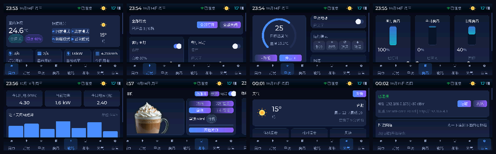

*上排：首页 · 灯光 · 空调 · 窗帘　｜　下排：能耗 · 咖啡机 · 天气 · 设置（真机截屏）*

---

## 目录

- [1. 它长什么样](#1-它长什么样)
- [2. 功能总览](#2-功能总览)
- [3. 网页控制面板（重点）](#3-网页控制面板重点)
- [4. 快速开始](#4-快速开始)
- [5. 配置](#5-配置)
- [6. 串口事件协议（给 STM32 等外设）](#6-串口事件协议给-stm32-等外设)
- [7. 串口命令行](#7-串口命令行)
- [8. 网页 API](#8-网页-api)
- [9. 目录结构](#9-目录结构)
- [10. 设计说明与性能取舍](#10-设计说明与性能取舍)
- [11. 开发工具](#11-开发工具)
- [12. 已知限制](#12-已知限制)
- [13. 致谢与许可](#13-致谢与许可)

---

## 1. 它长什么样

真机截屏（用项目自带的 `shot` 命令从串口导出，见 [11. 开发工具](#11-开发工具)）：

| 首页 | 灯光 | 空调 | 窗帘 |
|---|---|---|---|
| 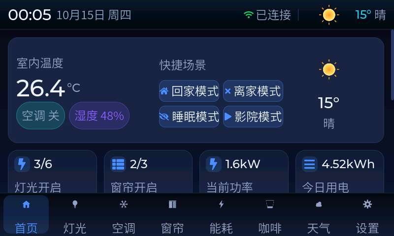 | 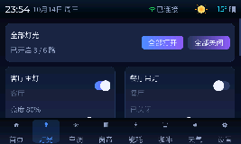 | 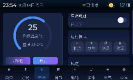 | 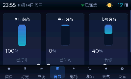 |

| 能耗 | 咖啡机 | 天气 | 设置 |
|---|---|---|---|
| 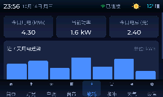 | 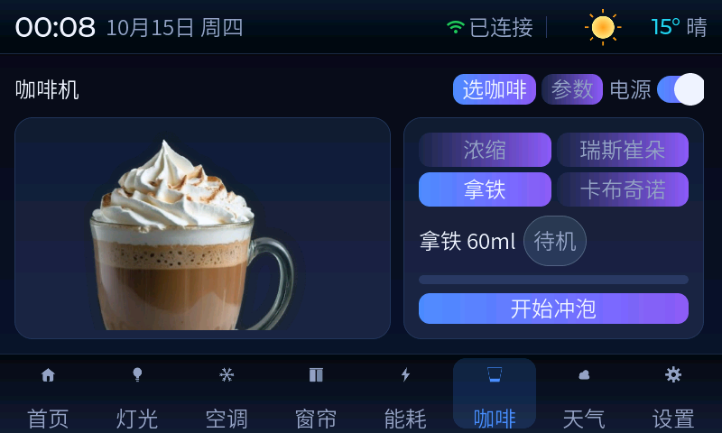 | 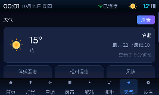 | 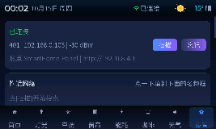 |

## 2. 功能总览

| 界面 | 能做什么 |
|---|---|
| **首页** | 室内温度大字、4 个快捷场景（回家/离家/睡眠/影院）、关键指标、6 个设备入口 |
| **灯光** | 6 路灯：开关 + 亮度滑条 + 一键全开/全关；氛围灯带 6 色预设 |
| **空调** | 圆弧拖拽设定温度（16~30℃）、4 种模式、4 档风速、摆风、电源开关、室温实时模拟 |
| **窗帘** | 3 路：竖直进度可视化 + 定位滑条 + 开/停/关，运动过程有动画 |
| **能耗** | 今日用电 / 当前功率 / 电费，近 7 天柱状图，数据每秒累加 |
| **咖啡机** | 4 种咖啡（浓缩/瑞斯崔朵/拿铁/卡布奇诺）+ 大图预览；咖啡量/牛奶量/浓度/水温四条参数；杯数 x1/x2；一键冲泡（研磨→冲泡→打奶→奶泡→完成，带进度条与阶段提示）；水箱/豆仓/今日杯数；缺水缺豆会拒绝启动并提醒 |
| **天气** | 实时大卡（自绘图标）+ 体感/湿度/风速 + 未来 3 天预报 + 手动刷新（Open-Meteo，免 API key） |
| **设置** | WiFi 扫描 + 屏幕键盘配网 + 保存 NVS + 忘记网络；背光亮度；热点信息；关于页 |

**跨模块联动**：回家 → 开灯、开空调、开窗帘、咖啡机开机；离家 → 关灯、关空调、关窗帘、咖啡机待机；
睡眠 → 只留卧室床头 15% 暖光、空调 26℃ 低风、窗帘关闭；影院 → 只留客厅氛围灯紫 40%、空调 24℃ 送风。

底部导航 8 格（首页/灯光/空调/窗帘/能耗/咖啡/天气/设置），切屏淡入，操作有气泡提示。

## 3. 网页控制面板（重点）

板子自己就是一个 Web 服务器，**手机浏览器打开就能控制，不用装任何 App**。

<p align="center">
  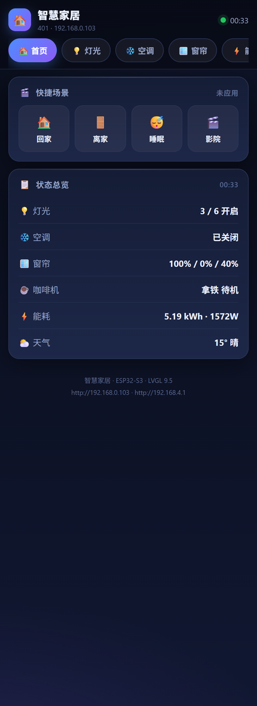
  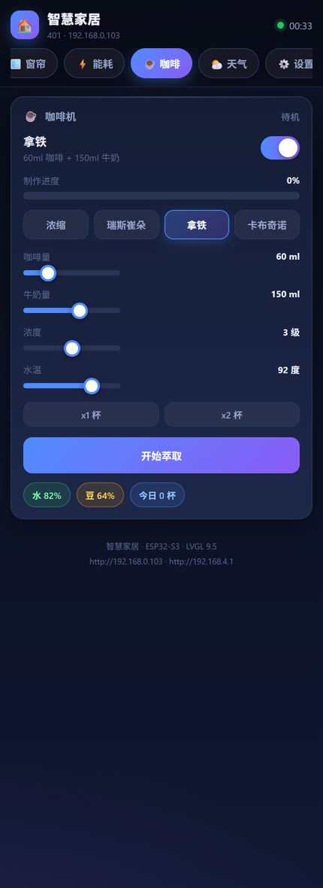
  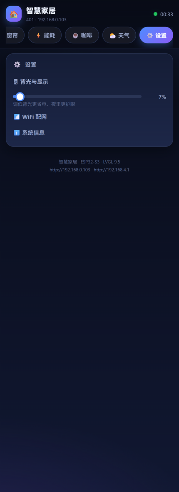
</p>

*真机截屏（无头 Edge 实拍）：首页总览 / 咖啡机 / 设置。顶部 8 个页签与屏幕上的 8 个界面一一对应。*

### 三种访问方式

| 方式 | 怎么做 |
|---|---|
| **连板子自己的热点**（最省事，不需要路由器） | 手机 WiFi 连 `SmartHome-Panel`（密码 `12345678`）→ 浏览器打开 `http://192.168.4.1` |
| 同一局域网 | 手机连家里路由器 → 浏览器打开板子 IP（屏幕「设置」页可见，或串口发 `wifi?`） |
| mDNS（免记 IP） | `http://smart-home.local`（iOS 通常支持，安卓看浏览器） |

> 热点与联网**同时工作**（AP+STA 并存）：手机连热点控制的同时，板子照常连路由器取天气和时间。
> 手机连热点时若提示"无法访问互联网"，选**保持连接**即可（这是正常的，热点不提供外网）。

### 网页做了什么

- **顶部 8 个页签**，与屏幕上的 8 个界面一一对应
- **双向同步**：
  - 屏幕 → 网页：状态一变就推送（SSE），最慢 1.2 秒兜底轮询也会跟上
  - 网页 → 屏幕：点一下手机，**屏幕立刻跟着变**，并弹出提示条（例如"空调 制冷模式 已开启"）
  - 点网页页签，**屏幕会切到同一个界面**；屏幕切页，网页页签也跟着切
- 可控：场景 / 灯光（含氛围灯配色）/ 空调 / 窗帘 / 咖啡机 / 背光 / 天气城市 / WiFi 配网
- 可看：天气（体感、湿度、风速、3 天预报）、能耗（今日、功率、电费、7 天柱状）、系统信息（IP、热点、剩余内存、运行时长）
- **可"添加到主屏幕"**：带 PWA 清单与图标，加完像原生 App 一样全屏打开

## 4. 快速开始

```bash
cd examples/platformio/smart_home_lvgl9
pio run -e BOARD_VIEWE_UEDX80480050E_WB_A -t upload
pio device monitor          # 115200
```

- 烧录前**先关掉串口监视器**（PlatformIO / VSCode 的 Serial Monitor 会占用 COM 口，表现为"拒绝访问"）
- 当前固件体积：**Flash 4,197,558 B（25.0%）**，静态 RAM **54.5 KB**（16MB Flash / 8MB PSRAM 板子）
- 编译平台：PlatformIO + [pioarduino](https://github.com/pioarduino/platform-espressif32) 53.03.11（Arduino 3.1.1 / ESP-IDF 5.x）
- 已验证开发板：**VIEWE UEDX80480050E-WB-A**（5 寸 800×480 RGB 触摸屏）
  `smart_home_lvgl9` 也带了 `BOARD_VIEWE_UEDX80480070E_WB_A`（7 寸）的 env

## 5. 配置

都在 `src/app_config.h`：

```c
/* WiFi：留空 → 开机后到「设置」页用屏幕键盘配网（凭据存 NVS） */
#define APP_WIFI_SSID     ""
#define APP_WIFI_PASSWORD ""

/* 板子自己的热点：手机直连控制用（AP+STA 并存） */
#define APP_AP_ENABLE   1
#define APP_AP_SSID     "SmartHome-Panel"
#define APP_AP_PASSWORD "12345678"     /* 至少 8 位；填空 = 开放热点 */

/* 时间与天气 */
#define APP_TZ               "CST-8"   /* POSIX 时区，中国是 CST-8 */
#define APP_WEATHER_PROVIDER 0         /* 0 = Open-Meteo（免 key，默认）；1 = 心知天气 */
#define APP_WEATHER_CITY     "hefei"   /* 拼音/英文，也可在网页或设置页里改 */
#define APP_DEFAULT_BRIGHTNESS 80

/* 串口事件（给外接单片机） */
#define APP_EVENTS_ENABLE 1
#define APP_EVENTS_STYLE  0            /* 0 = 中文协议；1 = ASCII */
```

## 6. 串口事件协议（给 STM32 等外设）

板子把**每一个可交互动作**都从串口发一行（115200，`\n` 结尾），方便外接单片机跟随状态。
所有日志行都以 `[` 开头（`[cli]`/`[nav]`/`[app]`…），**事件行不带前缀**，单片机按前缀过滤即可。

**风格 0（默认，中文）：**

```
灯光-全部打开              灯光-客厅主灯-打开        灯光-客厅主灯-亮度 80%
窗帘-客厅窗帘-打开         窗帘-客厅窗帘-位置 45%    空调-电源-开
空调-目标温度 26           空调-模式-制冷            空调-风速-低风
插座-热水器-打开           场景-回家模式             咖啡机-电源-开
咖啡机-类型-拿铁           咖啡机-咖啡量-60ml        咖啡机-牛奶量-150ml
咖啡机-浓度-4              咖啡机-水温-92            咖啡机-杯数-2
咖啡机-开始-拿铁           咖啡机-阶段-打奶中        咖啡机-完成-2杯
咖啡机-停止                咖啡机-提醒-请加水        界面-灯光
背光-80%                   城市-hefei                天气-刷新
```

**风格 1（`APP_EVENTS_STYLE 1`）：**

```
LIGHT_ALL 1        LIGHT 0 1        LIGHT_BRIGHT 0 80      CURTAIN 0 OPEN
AC_POWER 1         AC_TARGET 26     AC_MODE 0              SCENE 0
COFFEE POWER 1     COFFEE TYPE 2    COFFEE START 2         COFFEE DONE 2
```

设计上的两个细节：

1. **滑块类事件做了节流**（≤150 ms 一条）并在松手时补发最终值 —— 拖亮度不会刷屏，但最终值一定不丢
2. **场景不发"连环事件"**：应用"离家模式"时只发一行 `场景-离家模式`，不把连带的十几个设备动作逐条喷出来（内部静默开关控制）
3. 上电会先发一次 `sync` 全量状态，方便单片机对齐初始状态（也可随时手动发 `sync`）

## 7. 串口命令行

115200，行尾回车。输入 `help` 看全部：

| 命令 | 说明 |
|---|---|
| `wifi <SSID> <密码>` | 连接并保存到 NVS（密码可省略 = 开放网络） |
| `wifi?` | 查看连接状态（SSID / IP / 信号） |
| `forget` | 清除已保存的 WiFi |
| `scan` | 扫描附近 AP |
| `ui <0-7>` | 切屏：0 首页 1 灯光 2 空调 3 窗帘 4 能耗 5 咖啡 6 天气 7 设置 |
| `city [名称]` | 查看/设置天气城市（拼音） |
| `scene <0-3>` | 应用场景：0 回家 1 离家 2 睡眠 3 影院 |
| `coffee start\|stop\|type <0-3>\|water <0-100>\|beans <0-100>` | 咖啡机：冲泡 / 停止 / 选类型 / 设置水箱、豆仓（方便测试缺料提醒） |
| `events 0\|1` | 关闭/打开串口事件输出 |
| `sync` | 重发一次全量设备状态（给 STM32 对齐） |
| `shot [步长]` | **把当前屏幕截图从串口导出**（见第 11 节） |
| `heap` | 打印内存占用 |
| `reboot` | 重启 |

## 8. 网页 API

| 方法 | 路径 | 说明 |
|---|---|---|
| GET | `/` | 控制台页面（内嵌在固件里，共 ~43KB，不需要文件系统） |
| GET | `/manifest.json`、`/icon.svg` | PWA 清单与图标（可"添加到主屏幕"） |
| GET | `/api/state` | 设备状态快照 JSON（含时间、天气、灯光、空调、窗帘、咖啡机、能耗、WiFi、热点、系统信息） |
| POST | `/api` | 控制命令 JSON，见下 |
| GET | `:81/events` | **SSE 实时推送**（状态一变就推；20 秒心跳） |

> 推送为什么单独用 81 端口：ESP32 的 `WebServer` 库不支持长连接（回完响应就 `Connection: close`，
> 并声明 `Transfer-Encoding: chunked`，原始写入会被浏览器当成分块错误丢掉）。所以推送由自己写的
> 裸 socket 服务承担，并带 `Access-Control-Allow-Origin: *`。页面上另有 **1.2 秒兜底轮询**：
> 即便推送通道被防火墙拦掉，同步也不会失效。

控制命令示例（`POST /api`，`Content-Type: application/json`）：

```json
{"c":"light_all","on":1}
{"c":"light","id":0,"on":1,"br":80,"rgb":16711680}
{"c":"ac","on":1,"target":26,"mode":0,"fan":1,"swing":0}
{"c":"cur","id":0,"a":0}                 // a: 0 打开 / 1 停止 / 2 关闭 / 3 定位
{"c":"cur","id":0,"a":3,"pos":45}
{"c":"scene","id":0}
{"c":"coffee","type":2,"coffee_ml":60,"milk_ml":150,"temp":92,"cups":1}
{"c":"coffee","start":1}                 // 或 {"c":"coffee","stop":1}
{"c":"ui","id":5}                        // 让屏幕切到第 5 个界面（咖啡机）
{"c":"backlight","pct":80}
{"c":"city","name":"hefei"}
{"c":"wrefresh"}                         // 立即刷新天气
{"c":"scan"} / {"c":"wifi","ssid":"x","pass":"y"} / {"c":"wifi_forget"}
```

> 用 curl 之类的工具测试时**必须带 `Content-Type: application/json`**，否则会被当成表单提交。

## 9. 目录结构

```
smart_home_lvgl9/
├── platformio.ini                  # -O2、7MB app 分区、include 路径、115200 烧录
├── partitions_16MB_smart_home.csv  # 分区表（纯 ASCII）
├── DESIGN.md                       # 设计规格（配色/间距/控件尺寸，便于在 SquareLine 里复刻）
├── lib/                            # 离线依赖：lvgl 9.5.0 / ESP32_Display_Panel / esp-lib-utils / ArduinoJson
├── tools/                          # 开发工具（Python + PowerShell，见第 11 节）
└── src/
    ├── main.cpp                    # 板级初始化 → lvgl_port → ui_init → app_services_start → web_panel_init
    ├── app_config.h                # 所有可配置项
    ├── lv_conf.h                   # LVGL 9.5 配置（含 SNAPSHOT=1，供截屏用）
    ├── lvgl_v9_port.{h,cpp}        # 显示/触摸/flush/防撕裂移植层
    ├── lv_font_cjk_24.c            # 中文字库（思源黑体 24px + ASCII，回退 Montserrat）
    ├── app/                        # 业务层
    │   ├── device_model.{h,cpp}    # 设备状态 + 模拟 + 场景联动（接真硬件只改这里）
    │   ├── app_events.{h,cpp}      # 串口事件协议（动作上报 + 节流 + 静默开关）
    │   ├── web_panel.{h,cpp}       # 网页控制面板：HTTP + SSE + mDNS
    │   ├── index_html.h            # 由 src/web/index.html 生成（tools/html_to_c.py）
    │   ├── wifi_manager.{h,cpp}    # STA 连接/重连/扫描/NVS + AP 热点
    │   ├── weather_service.{h,cpp} # HTTP + ArduinoJson + 3 天预报 + 演示数据
    │   ├── time_service.{h,cpp}    # SNTP + 时区 + 中文日期
    │   ├── serial_cli.{h,cpp}      # 串口命令行
    │   └── lv_mem_psram.c          # LVGL 堆放到 PSRAM（8MB 里划 4MB 给 LVGL）
    └── ui/
        ├── ui.{h,c}                # 建屏/切屏/手势/提示条/异步提示队列
        ├── ui_theme.{h,c}          # 设计系统：配色、字体别名、卡片/按钮/滑条构建器
        ├── components/             # 状态栏、底部导航
        ├── screens/                # 8 个界面（每个一对 .c/.h）
        ├── images/                 # 导航与天气图标（由 tools/gen_icons.py 生成）
        └── images/coffee/          # 咖啡机素材（取自 lvgl_v9_coffee 工程，SquareLine 导出）
    └── web/index.html              # 网页控制台源码（改完跑 tools/html_to_c.py 重新内嵌）
```

## 10. 设计说明与性能取舍

**视觉**：深色玻璃拟态 —— 深蓝底 + 卡片上下渐变 + 1px 描边 + 蓝紫强调色；
图标全部本地生成（4 倍超采样 + LANCZOS 缩放），中文字体是思源黑体 24px 子集。

**为流畅做的取舍**（都能在代码里找到注释）：

| 做法 | 原因 |
|---|---|
| **不用阴影**（除个别小指示条） | LVGL 软件渲染里模糊阴影非常贵，卡片一多就掉帧；深色底上 1px 描边已足够分层 |
| **每个刷新都带"变化守卫"** | 每秒刷新的标签/滑条/文本只在值真的变了才写，避免无意义失效重绘 |
| **LVGL 堆放 PSRAM** | 内部 SRAM 只有 512KB，界面一大就 malloc 失败（表现为白屏）；改用 8MB PSRAM |
| **卡片不滚动、内容按尺寸设计** | 屏内信息量固定，避免滚动带来的重绘 |
| **咖啡大图用 `LV_IMAGE_ALIGN_CONTAIN`** | 自动等比缩放居中，且只在切换类型时才重绘 |
| **状态推送节流 + 去重（FNV-1a 哈希）** | 状态没变不推，网页不会被打爆 |
| **滑块事件节流 150ms + 松手补发** | 拖一次亮度只发十几条串口行，且最终值不丢 |

**线程模型**：LVGL 在独立任务里跑（`lvgl_port`，锁保护），业务在 `app_services` 任务里每 250ms 一拍；
从业务侧碰 UI（切屏、弹提示）一律走 `lv_async_call` 或"异步提示队列"，不跨任务直接动 LVGL 对象。

## 11. 开发工具

| 工具 | 用途 |
|---|---|
| `tools/gen_icons.py` | 用 Pillow 画导航/天气图标（4× 超采样 + LANCZOS），输出 LVGL C 数组 |
| `tools/png2lvgl.py` | PNG → LVGL 9 C 数组（RGB565A8 等格式） |
| `tools/html_to_c.py` | `src/web/index.html` → `src/app/index_html.h`（网页内嵌进固件） |
| `tools/check_font_coverage.py` / `check_font_glyphs.py` | 校验字库覆盖：哪些字能显示、哪些会变"方框" |
| **`tools/find_tofu.py`** | 全工程扫字符串字面量，找出**会显示成方框的字符**（本工程已清零；`--fix` 可自动替换） |
| **`tools/shot_capture.ps1`** | 把板子当前屏幕截屏导出成 PNG（配合固件的 `shot` 命令） |
| **`tools/shot_screens.ps1`** | 批量：依次切到 0~7 号界面并各截一张（README 的图就是这么来的） |

截屏协议：固件收到 `shot [步长]` 后先发一行 `@@SHOT <宽> <高> <步长> <行字节>`，
随后是 RGB565（小端）像素（按步长隔点采样，默认 1/2~1/3 以压缩体积），最后 `@@SHOT_END`。
截图在 LVGL 任务里做，发送放在后台任务逐行吐，不会卡界面。

## 12. 已知限制

- 设备状态是**模拟**的（灯/空调/窗帘/咖啡机都在 `device_model.cpp` 里跑状态机）；
  要接真实继电器/传感器，把 `dm_*_set()` 里的"改结构体"换成你的驱动调用即可，UI 和网页都不用动
- 中文字库是 **24px 单一字号**子集（3755 常用字）：界面上的"小字"实际也是 24px，
  想更精致需要再生成 16/18px 字库（`tools/find_tofu.py` 可用来验收缺字）
- 天气用 Open-Meteo（免 key）。国内直连速度尚可；若换心知天气，改 `APP_WEATHER_PROVIDER 1` 并填 key
- 网页推送端口固定 **81**；若所在网络屏蔽该端口，页面会自动退化为 1.2 秒轮询（功能不受影响）

## 13. 致谢与许可

- 板级驱动与出厂例程：**VIEWE** 提供的 `esp_panel` / `esp-lib-utils`（本工程的 `lib/` 内已离线 vendor）
- 图形库：[**LVGL 9.5.0**](https://lvgl.io/)（MIT）
- 咖啡机界面素材（`src/ui/images/coffee/`）：取自同仓库的 **`lvgl_v9_coffee`** 工程（SquareLine Studio 导出）
- 天气数据：[**Open-Meteo**](https://open-meteo.com/)（免费、免 API key）
- 中文字体：**思源黑体**（Source Han Sans，SIL OFL 1.1）

本工程代码可自由使用/修改；第三方素材与字体的授权请遵循各自原始许可。
